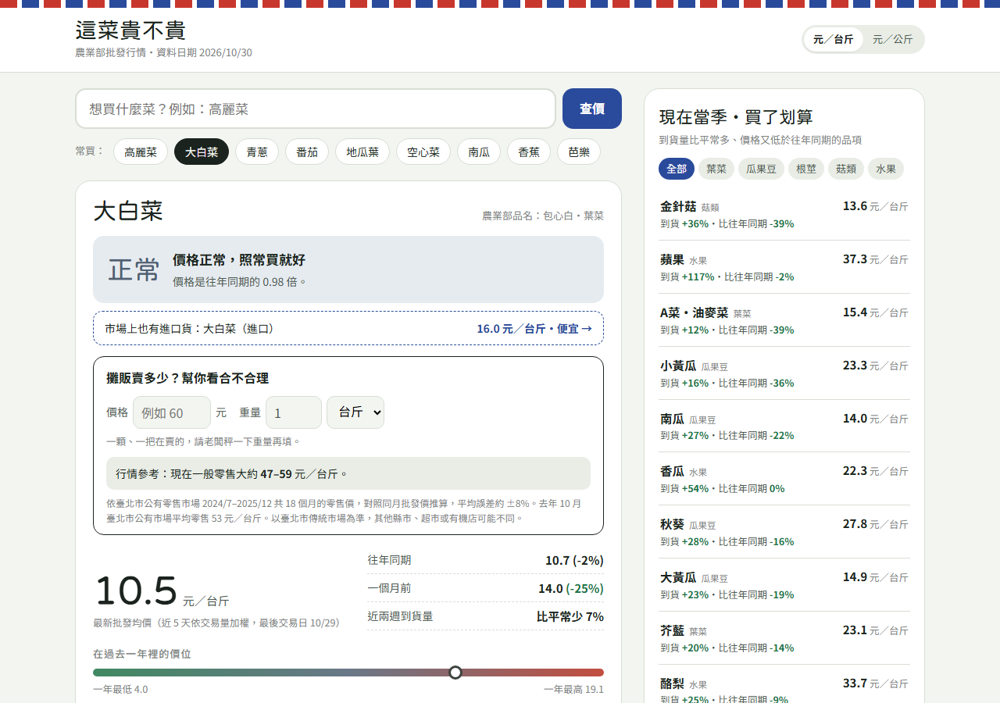
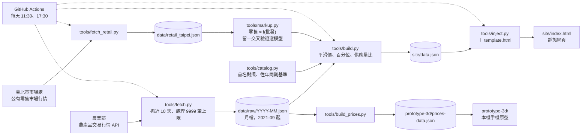

# 這菜貴不貴

> 用農業部過去五年的果菜批發行情，判斷蔬果「今天的價格和往年同一時期比起來」是便宜、正常還是偏貴；太貴時推薦同類當季的替代品，也能輸入攤販開價，看看合不合理。資料由 GitHub Actions 每天自動抓取、重算並產生靜態網頁。

## 要解決的問題

去市場買菜時很難知道「高麗菜一斤 40 元算貴嗎？」。政府有公開每日批發行情，但原始資料是逐市場、逐品種的成交紀錄，一般人看不懂，而且「貴不貴」要跟**同一季節**比才有意義（夏天的高麗菜本來就比冬天貴）。這個專案把五年批發資料整理成一個查得懂的答案，並估出攤販零售價的合理區間。

## Demo

查詢大白菜時的網站畫面：貴不貴判斷、攤販價格參考、最新批發價與右側的當季推薦。以 repo 內的資料在本機執行 `tools/build.py`、`tools/inject.py` 產生網頁後截圖（資料日期 2026/10/30，視窗寬 1280px）。



另有一個手機比例的本機原型（`prototype-3d/`，未公開部署）：3D 貓咪帶路找今天最划算的菜，下方抽屜是今日菜價清單，另含採買筆記。截圖為本機執行 `start_app.py` 所拍；原型使用的是 2026-10-08 的快照（`prototype-3d/prices-data.json`），距今超過 7 天，所以公佈欄依設計顯示「沒有最近的交易資料」，不拿舊資料冒充今日價格。


**線上網站**：workflow 設計為部署到 GitHub Pages（`https://mina201199.github.io/veggie-price-tw/`），但 2026-10-30 確認此網址回 404、repo 尚未啟用 Pages，部署步驟因此失敗；目前請用本機執行（見下方）。

## 架構



計算都在 Python 端完成；網頁（`tools/template.html`）只讀 `data.json` 裡算好的數字再套門檻。網站與原型共用 `tools/catalog.py` 的品名對照與往年同期規則，避免兩邊判斷不一致。

## 技術重點與設計決策

本專案是**統計規則與簡單迴歸**，沒有使用機器學習模型或 LLM（原型採買筆記的「自動辨識」按鈕已預留介面，但未接任何模型）。

- **近 5 天量加權平滑價**：同一常用名底下各品種、各市場的成交依交易量加權；每日價格取「當天與前 4 天」有交易日子的加權平均，避免市場休市、到貨組合不同造成鋸齒跳動。最近 10 天沒有交易視為非產季。
- **往年同期基準用中位數**（`tools/catalog.py` 的 `same_period_baseline`）：取前 5 年、每年同一天前後 15 天的平滑價取中位數，不讓單一颱風年拉偏基準；合計少於 20 天或不到 2 個年份就顯示「難判斷」，不硬比。價格比 ≤ 0.88 便宜、≤ 1.12 正常、≤ 1.35 偏貴，再高為很貴。
- **補充脈絡**：近一年百分位（至少 30 天資料）與供應量比（近 14 天日均量 ÷ 過去一年日均量）。例如價格比正常但百分位 ≥ 85% 時，提示「這時節本來就是它一年中比較貴的時候」。
- **攤販零售價估計**（`tools/markup.py`）：用臺北市公有市場月均零售價對上同月批發價，比較「中位數倍數」與「最小平方線性」兩種模型，以**留一交叉驗證**的誤差中位數挑模型；合理區間依驗證誤差設定並限制在 ±12%～±35%；超出建模範圍時不外推。沒有零售資料的品項借用國產同品項或同類別倍數，區間放寬。
- **抓資料的工程細節**（`tools/fetch.py`）：API 單次最多回 9999 筆，需分段抓；部分節點憑證缺 Subject Key Identifier，Python 3.13 嚴格檢查會擋，因此保留憑證驗證、只關閉 `VERIFY_X509_STRICT` 旗標。
- **零相依**：資料管線只用 Python 標準函式庫；原型的 3D 場景使用固定版本的 Three.js（vendor 進 repo），可離線載入。

## 成果與數字

| 項目 | 數值 | 來源 |
|---|---|---|
| 批發行情資料 | 62 個月檔（2021-09 至 2026-10） | `data/raw/` |
| 自動更新 | 每天 2 次排程抓資料並 commit 回 repo | `.github/workflows/update.yml`、git log 中 `github-actions[bot]` 的「資料更新」commit |
| Python 測試 | 23 個 `tools/` 測試 OK；`prototype-3d/test_launcher.py` 1 個測試 OK | 2026-10-30 本機執行 |
| Node 測試 | `prototype-3d/*.test.cjs` 9 個檔案全部通過 | 2026-10-30 本機執行 |

沒有使用者流量或回饋數據，因此不列使用成效。

## 如何執行

需要 Python 3.10 以上，不用安裝任何套件。

```bash
python tools/fetch.py          # 抓最近 10 天批發行情，合併進 data/raw/ 月檔
python tools/fetch_retail.py   # 抓臺北市零售行情
python tools/build.py          # 算指標 → site/data.json
python tools/inject.py         # 產生網頁 → site/index.html
```

repo 內已附資料，只想看網頁可以略過前兩步，直接執行 `build.py`、`inject.py` 後用瀏覽器開 `site/index.html`。

本機手機原型：Windows 雙擊 `Start-App.cmd`，或執行 `python start_app.py`（預設開 <http://localhost:8877/prices.html>）。更新原型的菜價快照：`python tools/build_prices.py`。原型細節見 [prototype-3d/README.md](prototype-3d/README.md) 與 [prototype-3d/PRICES-README.md](prototype-3d/PRICES-README.md)。

測試：

```bash
python -m unittest discover -s tools
python -m unittest prototype-3d/test_launcher.py
for f in prototype-3d/*.test.cjs; do node "$f"; done   # 需要 Node.js
```

## 已知限制與下一步

- 批發行情不等於個別店家的即時零售價，也不代表商品品質；資料已彙整全臺市場，無法比較個別市場。
- 零售估計只有臺北市公有市場的月均價可對照，其他縣市與進口品項是借用倍數推估，區間較寬。
- GitHub Pages 尚未啟用，線上網站目前無法瀏覽。
- 原型（`prototype-3d/`）是手機比例的瀏覽器原型，不是已打包的 App；採買筆記只存在使用者瀏覽器（localStorage／IndexedDB），沒有帳號或雲端同步；城市探索的街區、距離、點數皆為示意。原型的菜價快照沒有排程更新。
- **下一步**：啟用 Pages 恢復每日部署；把原型快照納入同一個排程；接上收據照片的辨識（目前只預留介面）。

## 我負責的部分

個人專案，獨立完成：需求、資料取得與清洗、價格判斷規則與零售估計模型、網頁與手機原型、自動化部署、測試與文件。

## 資料來源與授權

- 農業部農業資料開放平臺「農產品交易行情」：全台果菜批發市場每日成交價與交易量。
- 臺北市市場處「臺北市公有零售市場行情」：每月各品項平均零售價。

程式碼以 [MIT License](LICENSE) 釋出；`prototype-3d/vendor/` 內的 Three.js 依其授權（`prototype-3d/vendor/THREE-LICENSE.txt`）。
